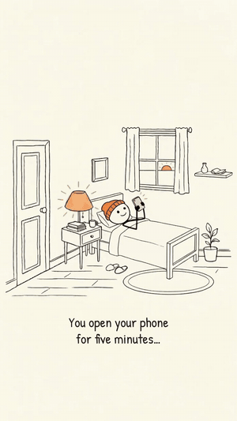
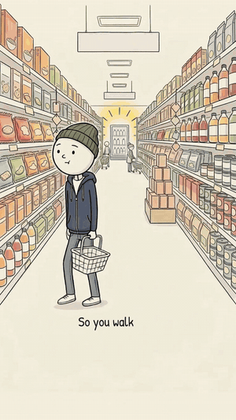
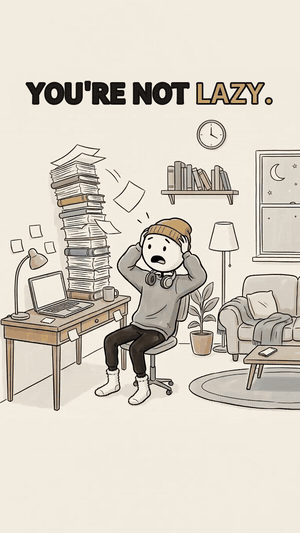
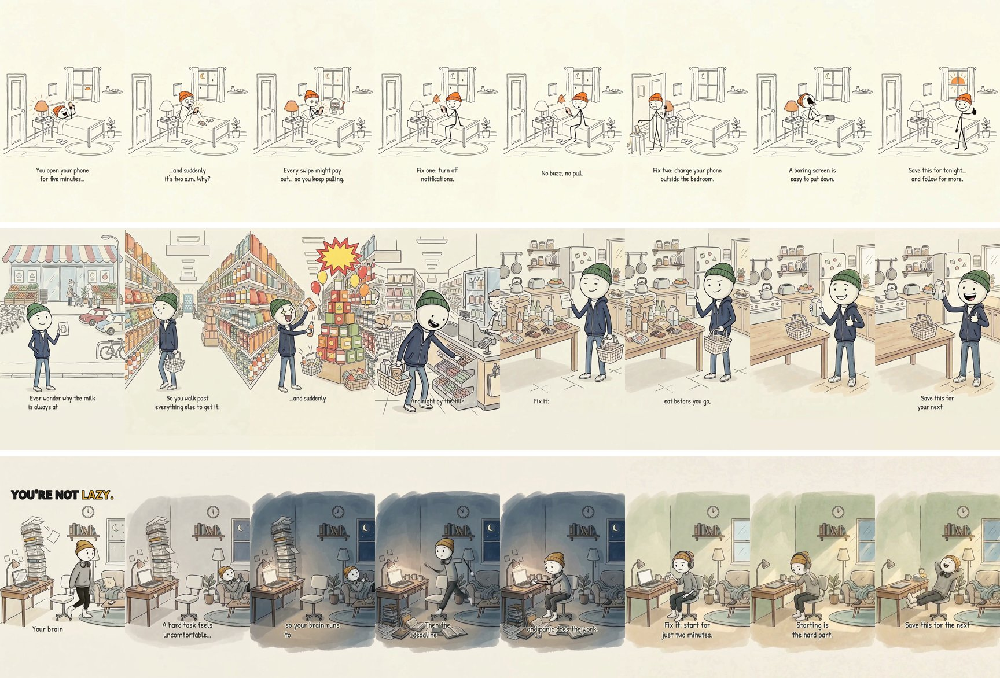
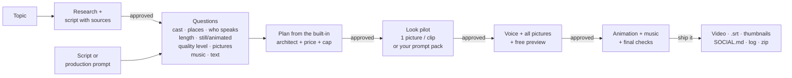

# Script to Video

**Give it a topic or a script. Answer a few questions. Pick a price. Say "approved". Get a finished video.**

Script to Video is a skill (and Claude Code plugin) that turns a topic or a script into a finished, narrated video —
vertical Shorts/Reels/TikTok or landscape YouTube, any length, any style. You choose the quality level and see the price
first: from about **$0.50 for a 30-second animated Short** when you make the pictures yourself, to about **$3.30** with
the premium models doing everything. It was built in real production (a children's phonics series and a psychology
explainer series) and works for any topic: lessons, stories, explainers, product videos, documentaries, real-looking
people or your own footage.

[](LICENSE)

<table>
<tr>
<td align="center"><br><b>Your Phone Is a Slot Machine</b><br>31 s · $0.96 · <a href="docs/videos/hitap-ep1-your-phone-is-a-slot-machine.mp4">full video</a></td>
<td align="center"><br><b>Why the Milk Is at the Back</b><br>27 s · $0.58 · <a href="docs/videos/hitap-ep2-why-the-milk-is-at-the-back.mp4">full video</a></td>
<td align="center"><br><b>You're Not Lazy</b><br>21 s · $0.47 · <a href="docs/videos/hitap-ep3-youre-not-lazy.mp4">full video</a></td>
</tr>
</table>

*Three real Shorts made with this skill: pictures made by the creator from the skill's prompts, animation, voice,
music, captions and sound all produced by the skill. Previews are silent; open "full video" for sound.*

---

## What you get

- **Just a topic or a script** — no prompt to paste. The master prompt is built into the skill as its
  [architect](skills/script-to-video/references/architect.md) (open for anyone to read).
- **Topic only?** It researches the topic on the web, writes the script with sources, and waits for your approval.
- **It designs the video for you** — your script is arranged into a full **production plan** (`BRIEF.md`): style lock,
  cast (one presenter or 2–4 characters), locations, every scene (picture, action, lines, caption), voices, music,
  models, cost and the approval steps. Keep it and reuse it for the next video.
- **Your choice of quality, with prices** — Budget (Nano Banana 2 + MiniMax), Sharper pictures (Nano Banana Pro),
  Better motion (Kling 2.6 Pro) or Premium (both), for still or animated videos. Every option is priced before you choose.
- **Director mode** — paste a full production prompt of your own and your scene descriptions, actions and lines are kept
  word for word; only technical problems are fixed, and each fix is listed.
- **One voice or a conversation** — an unseen narrator, a character who narrates, or **dialogue** between characters,
  each with their own voice (voice-over; mouths are not lip-synced).
- **A guided intake** — length, vertical or landscape (suggested from length), video style, still or animated,
  who makes the pictures, voice, music and on-screen text (or none). It suggests an answer for each.
- **The full price before anything is paid for**, with a spending cap. Nothing that costs money runs until you type **approved**.
- **Two picture routes**
  - *Made for you* on fal.ai (about $0.08 a picture), framed with a layout guide so the subject always sits right.
  - *Made by you* in any tool you like, free ones included: you get **exactly the prompts the skill would use**
    (same words, same reference pictures in the same order, character sheet and locations first), a layout guide and
    naming rules; upload them to the chat or a shared Google Drive folder and the rest is automatic.
- **Still or animated**
  - *Still*: smooth camera moves on every picture, made locally for free.
  - *Animated*: every picture becomes a short clip — looping, freely acted, or **chained** picture to picture as one
    continuous shot.
  - *Mixed*: animate only the moments that matter.
- **Proper sound**: AI narration (or your recording), new music (or yours, or none) that automatically drops under the
  voice, free synthesised sound effects, room ambience, broadcast-correct loudness, and separate sound tracks for CapCut.
- **On-screen text only if you want it**: none, subtitles, key words, or teaching words with timed colour changes
  ([see the options](docs/images/text-modes.png)).
- **A ready-to-post package**: the video, a captions file (.srt), thumbnails, YouTube chapters, and **SOCIAL.md** with
  captions, hashtags, titles, descriptions and tags for Instagram, TikTok, YouTube (Shorts and long-form) and Facebook.
- **Checks at every step**: pictures are checked for text, bands and wrong shapes; the final video is checked for length,
  timing, loudness and spelling (frame grabs at every text change).


## What it costs

The skill shows this menu (with live prices) for every video and you choose. A 30-second animated vertical video:

| Level | Pictures | Animation | Pictures made for you | Your own pictures |
|---|---|---|---|---|
| **Budget** | Nano Banana 2 | MiniMax H3 | about $1.19 | about $0.63 |
| **Sharper pictures** | Nano Banana Pro (2K) | MiniMax H3 | about $1.68 | about $0.63 |
| **Better motion** | Nano Banana 2 | Kling 2.6 Pro | about $2.78 | about $2.22 |
| **Premium** | Nano Banana Pro (2K) | Kling 2.6 Pro | about $3.27 | about $2.22 |
| **Still** (free camera moves) | Nano Banana 2 / Pro | — | about $0.68 / $1.17 | about $0.12 |

Music: new (+$0.08 a track), your own, or none. Your own pictures + your own voice + no new music + still = **$0 paid**.
Camera moves, text, effects, mixing, loudness, thumbnails, captions and packaging are always free and local.

### Real videos made with it


| Video | Length | How | Cost |
|---|---|---|---|
| Hi Tap Ep. 1 — Your Phone Is a Slot Machine | 31 s, 7 scenes | own pictures, Budget animation, voice, no music | $0.96 (incl. $0.35 on a dropped test style) |
| Hi Tap Ep. 2 — Why the Milk Is Always at the Back | 27 s, 6 scenes | own pictures, Budget animation, voice, music | $0.58 |
| Hi Tap Ep. 3 — You're Not Lazy | 21 s, 5 scenes | own pictures, chained animation, voice, music | $0.47 |
| Stick & Sound Ep. 2 (phonics) | 60 s, 12 scenes | pictures made here, Budget animation, voice, music | $2.36 |

## How it works



---

## Install

You need three things: **the skill**, **the fal connector** (for anything generated; it is optional for the $0 route)
and a place where Claude can run code (Claude Code, or the Claude app with code execution on).

### Option A — Claude Code (recommended)

1. Install the plugin:
   ```bash
   claude plugin marketplace add Topnotch1851/script-to-video
   claude plugin install script-to-video@script-to-video
   ```
2. Connect fal (sign in with your browser; no API key is pasted anywhere):
   ```bash
   claude mcp add --transport http --scope user fal https://mcp.fal.ai/mcp-relay
   ```
   Then start `claude`, type `/mcp`, choose **fal** → **Authenticate**, and finish the sign-in.
3. Make sure Python 3.9+ and ffmpeg are installed:
   ```bash
   python3 -m pip install Pillow numpy        # add imageio-ffmpeg if you cannot install ffmpeg
   ffmpeg -version
   ```
4. Add credit to your fal.ai account (a few dollars is plenty to start).

### Option B — Claude app (claude.ai on the web, or Claude desktop)

1. Download **[`script-to-video-skill.zip`](https://github.com/Topnotch1851/script-to-video/raw/main/download/script-to-video-skill.zip)** (the skill folder, ready to upload).
2. In Claude, make sure **code execution** is turned on in your settings (skills need it).
3. Go to **Customize → Skills**, upload the zip, and switch the skill on.
4. Add the fal connector: in your connector settings choose **Add custom connector**, use the URL
   `https://mcp.fal.ai/mcp-relay`, and sign in.
5. Optional: connect **Google Drive** if you will make your own pictures and share them from a Drive folder.

### Option C — copy the skill folder by hand (Claude Code without plugins)

```bash
git clone https://github.com/Topnotch1851/script-to-video.git
mkdir -p ~/.claude/skills && cp -r script-to-video/skills/script-to-video ~/.claude/skills/
```
Then connect fal as in Option A, step 2.

### Option D — other AI assistants

fal's connector also works with ChatGPT, Codex, Cursor and any MCP client. Give your assistant the
`skills/script-to-video` folder (or clone the repo into its workspace), make sure it can run Python, and tell it:
"Follow skills/script-to-video/SKILL.md to make me a video about …". The tools are plain Python and ffmpeg.

---

## Make your first video (step by step)

1. **Open a new chat** (Claude app) or start `claude` in an empty folder (Claude Code).
2. **Say what you want.** One line is enough:
   ```text
   /script-to-video:make-video a 35-second sitcom-style video for small business owners about password managers
   ```
   In the Claude app: *"Use script-to-video to make me a video about …"*. Have a script? Paste it after the command
   instead of a topic. You can add anything you already know ("still, my own pictures, no music") to skip questions.
3. **Topic only? Approve the script.** The skill researches the topic and shows you a script with its sources.
4. **Answer the questions.** Only what is still open: duration, still or animated, who is on screen, who speaks, style,
   who makes the pictures, music, on-screen text. Each comes with a suggestion; "yes to all" is fine.
5. **Pick your quality level.** You see the price of every model level for your video and choose one.
6. **Read the plan and approve.** Cast, places and every scene (picture, action, lines, caption), the cost and the
   spending cap. Type **approved** to start. Keep `BRIEF.md`: hand it back any time to make another video like it.
7. **Approve the look.** You see one pilot picture (and one clip if animated).
   *Making your own pictures?* You get `PICTURE-PROMPTS.md` instead — exactly the prompts the skill would use: make the
   character sheet and location pictures first, then each scene with the references it lists; name them `01.png`,
   `02.png` …, and attach them or share a Google Drive folder link.
8. **Approve the preview.** All pictures with the narration, text and effects, as a free preview (no music yet).
9. **Approve the final.** Animation (if chosen) and music are added, the video is checked, and you see it.
   Say **ship it** or ask for changes.
10. **Download your package**: the video, captions file, thumbnails, SOCIAL.md with posts for each platform, separate
   sound tracks, the picture prompts, the production log with every cost, and one zip with everything.

Worked examples:
- [`examples/topic-only-sitcom`](examples/topic-only-sitcom) — a one-line topic turned into a three-character sitcom
  video with dialogue: the brief the skill wrote, the shot list and every generated prompt. Quote: $1.27 for 35 s animated.
- [`examples/why-the-sky-is-blue`](examples/why-the-sky-is-blue) — a finished script, still pictures you make yourself,
  subtitles. Quote: $0.12 for 30 s.

## How the skill thinks: the built-in master prompt

Every video is planned with the same [architect](skills/script-to-video/references/architect.md): a director-style
master prompt (what we are making, style lock, cast, locations, models and money, then four phases with approval
gates and delivery). The skill fills it in from your topic or script and shows it to you as `BRIEF.md`.

**Already have a production prompt of your own?** Paste it after the command. Director mode keeps your scene
descriptions, actions, lines, cast and style lock word for word, suggests the models you named (with the price menu),
and fixes only what is technically broken — text drawn by the AI, "leave the top empty" framing, hosted video joining,
missing music or captions, repeated lines in a series — listing each change before anything runs.

## Casts, locations and dialogue

For videos with several characters the skill makes one **cast sheet** (everyone side by side, with expressions) and one
**reference picture per main location**, then sends the right ones with every scene so faces and rooms stay the same.
Cutaways are described in the scene. Each character gets a voice; lines in a scene play one after another and the scene
length is fitted to them. Acting scenes use free animation (a whole gag in one clip, up to 15 s); presenter scenes loop.

## Making a series

After the first video you get a **series bible**: the character sheet, voice, style, the outfits and settings
already used, and every line already spoken. Give it to the skill with the next topic. Each new
episode opens with a callback to the last one, never repeats a line, changes the outfit, settings and music,
and keeps the face, voice and style the same.

---

## Use the tools directly (for developers)

Everything local lives in `skills/script-to-video/scripts/` and reads one file, `shotlist.json`
([format](skills/script-to-video/references/shotlist.md)).

| Script | What it does |
|---|---|
| `new_project.py` | Create a project folder, starter shot list and layout guide |
| `plan_costs.py` | Price quote; `--menu` prints every model level, `--compare` still/mixed/animated |
| `prompt_pack.py` | Picture, animation and voice prompts, reference-picture prompts (cast sheet, locations) and fal job lists |
| `layout_guide.py` | The framing reference image for any format |
| `check_pictures.py` | Checks pictures (shape, size, bands, empty strips) + contact sheet |
| `fit_beats.py` | Times every beat to its narration (long videos) |
| `split_voice.py` | Splits one long voice recording into one file per beat |
| `build_beat.py` | Renders one beat (still camera move or clip + timed text) |
| `assemble.py` | Builds the whole video: pictures, voice, effects, ambience, ducked music, loudness, .srt, chapters |
| `qc.py` | Final checks: length, speech timing, loudness, frame contact sheet |
| `thumbnail.py` | YouTube (1280x720) and vertical cover thumbnails |
| `package.py` | Folder + zip + MD5 of everything |

```bash
K=skills/script-to-video/scripts
python3 $K/new_project.py my-video --title "My Video" --format vertical --seconds 60 --motion still
# …fill my-video/shotlist.json, add pictures/ and voice/ …
python3 $K/assemble.py my-video/shotlist.json my-video/final.mp4
python3 $K/qc.py my-video/shotlist.json my-video/final.mp4
```

## Troubleshooting

| Problem | Fix |
|---|---|
| "fal is not connected" | Add the connector (Install, step 2) and sign in; or choose the $0 route |
| A job seems stuck | It is checked by its request id; it is never resubmitted (that would charge twice) |
| `ffmpeg not found` | Install ffmpeg, or `pip install imageio-ffmpeg` |
| Writing appears inside a picture | That picture is re-made with the fault named (the AI is never asked to draw text) |
| A band or empty strip across a picture | Re-made; framing uses the layout guide, never "leave space empty" |
| The voice says a letter's name instead of its sound | Respell it ("kuh", "sss"); see `references/sound.md` |
| The preview has no music | Correct — previews are silent of music on purpose; music is added in the final step |
| Out of fal credit mid-way | Credit is checked before every batch; top up and continue from the same step |

## Responsible use

- Realistic AI people or events must be labelled when posted (YouTube "altered or synthetic content",
  TikTok "AI-generated", Meta "AI info"). SOCIAL.md reminds you.
- Only show real people with their consent; never imitate public figures, brands or logos.
- Videos aimed at children must be marked **made for kids** on YouTube.
- Use music you own or have licensed, or let the skill make new music.

## Repository layout

```
.claude-plugin/          plugin + marketplace manifests (Claude Code)
commands/make-video.md   /script-to-video:make-video
skills/script-to-video/  the skill: SKILL.md, references/, scripts/, templates/, fonts/, prices.json
examples/                worked examples
docs/images/             pictures used in this README
```

## Contributing

Issues and pull requests are welcome: new styles, better prompts, more platforms, other model providers.
Please keep the rules in `references/lessons.md`; each one exists because something went wrong without it.
Run both example builds and `claude plugin validate .` before opening a pull request.

## Credits and licence

MIT © 2026 Topnotch1851 — see [LICENSE](LICENSE).
Fonts: Andika (SIL International), Patrick Hand (Patrick Wagesreiter), Poppins (Indian Type Foundry),
all under the SIL Open Font License 1.1.
Generation runs on [fal.ai](https://fal.ai) models: Nano Banana 2 and Nano Banana Pro (pictures), MiniMax H3 and
Kling 2.6 Pro (animation), ElevenLabs v3 (voice), Lyria 3 (music). Prices belong to fal and can change; the skill checks them live.
